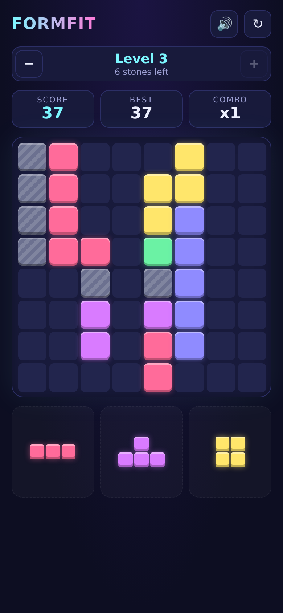

# Formfit

A block puzzle game played in levels. Drag pieces onto an 8×8 board, fill whole rows or columns to clear them,
and clear the grey stones to beat each level.

**Play it at <https://n03l.github.io/formfit/>**, on your phone or computer. It's free, with no account or sign-up.

## How to play

Hold your phone upright: the game is made for portrait. Once installed, it always opens upright.

- Below the board are **3 pieces**. Drag one onto the board with your finger or mouse. A shadow shows where it
  will land.
- If the piece doesn't fit where you drop it, it slides back to the tray.
- Pieces can't be rotated: place them as they come. The exception is a piece with a **↻** badge and a blue
  outline: **tap it** to turn it a quarter turn clockwise, as many times as you like, then drag it as usual. These
  pieces are rare in the first levels and show up more often from level 6.
- When all 3 are placed, you get 3 new ones.
- **Fill a whole row or column** and it clears. Rows and columns that are about to clear light up while you drag.
- A piece that doesn't fit anywhere on the board is greyed out in the tray. A ↻ piece only greys out if no turn of
  it fits.

## Levels

- **Goal:** each level starts with some **grey stones** on the board. Clear every stone, by filling the row or
  column it sits in, to complete the level.
- **Advancing:** completing a level gives you a bonus and takes you straight to the next one.
- **Getting harder, slowly:**
  - The first levels are gentle: level 1 has just 3 stones in a single row or column, and the stones of the early
    levels sit together along a line or two.
  - In the early levels, each new set of pieces usually includes one that can clear a line with stones in it, when
    one fits.
  - As you go up, each level adds more stones, spread over more rows and columns, and big, awkward pieces show up
    more often.
- **Same puzzle every time:** a level's stones are always in the same places, so you can replay it and get better.
  The pieces you're dealt are random.

The banner at the top shows the current level and how many stones are left:

- **−** goes back one level, to replay an easier puzzle.
- **+** goes forward one level, but only up to the level after the highest one you've completed.
- If you've already placed pieces, both buttons ask before leaving the level.

## Game over

If none of your pieces fit anywhere, the game is over. Press **Retry level N** to try the same level again.

## Scoring

| What | Points |
|---|---|
| Each block placed | 1 |
| Clearing lines in one move | 10 × lines × lines × combo |
| Emptying the whole board | 300 |
| Completing level N | 100 × N |

- **Clearing several lines at once pays more:** 1 line is 10 points, 2 lines are 40, 3 lines are 90 (before the
  combo).
- **Combo:**
  - Each move that clears a line raises the combo by 1, and the combo multiplies your line points.
  - Make 3 moves in a row without clearing anything and the combo resets.
- **Your score keeps growing** as long as you complete levels back to back. It goes back to 0 when you retry,
  restart or switch levels.
- **Best** is your highest score ever.

## Buttons

- **🔊 / 🔇:** sound on or off.
- **↻:** restart the current level.

## Your progress and offline play

- **Once loaded, the game runs entirely on your device.** Nothing you do in the game is sent anywhere: there's no
  account, no tracking and no ads. The only time it goes online is when you open it, to check for a newer version.
- Your best score, the levels you've unlocked and the game in progress are saved on your device, in this browser.
  Another phone or browser starts from scratch.
- You can install the game on your phone's home screen or your computer (**Add to Home Screen** or **Install
  app** in the browser menu). Once installed it also works offline.

## License

Formfit is free software, released under the GNU Affero General Public License, version 3 or later. See
[LICENSE](LICENSE).
